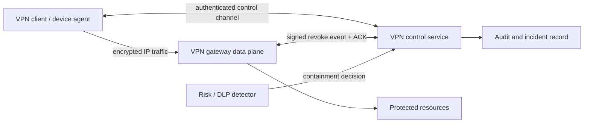

# 실시간 접근 철회로 VPN 데이터 유출 확산을 막는 설계


## 한 문장 요약

민감 데이터의 대량 반출 징후가 확인되면 인증 토큰 만료만 기다리지 않고, 사용자·기기·VPN 세션에 연결된 차단 이벤트를 게이트웨이에 전파해 기존 연결과 재접속을 함께 막는 실시간 대응 설계를 제안합니다.

## 문제

일반적인 인증은 접속 시점에 사용자를 확인하지만, 접속 후 권한이 철회되거나 비정상적인 데이터 반출이 감지돼도 이미 열린 터널과 애플리케이션 연결이 남을 수 있습니다. IdP 토큰을 만료시키는 것만으로 진행 중인 TCP 연결이나 게이트웨이의 전달 상태가 즉시 정리된다고 가정할 수 없습니다.

따라서 탐지 시스템과 데이터 경로 사이에 빠르고 인증된 제어 경로를 두고, 탐지 결과가 실제 패킷 전달 정책과 연결 상태에 반영되도록 해야 합니다.

## 목표와 범위

- 사용자·기기·세션 단위로 권한을 철회하고 해당 게이트웨이의 데이터 전달을 차단합니다.
- 진행 중인 연결을 정리하고, 기존 자격 증명으로 재접속하는 시도도 거부합니다.
- 제어 이벤트의 전달·적용·확인 상태를 추적해 Active-Active 게이트웨이 간 편차를 줄입니다.
- 정책 판단, 터널 세션, 차단 결과를 상관관계 ID로 감사할 수 있게 합니다.

이 제안은 WireGuard 프로토콜을 변경하지 않습니다. VPN의 데이터 경로와 별도로 제어 API 또는 제어 이벤트 채널을 둡니다. WireGuard는 UDP로 IP 패킷을 캡슐화하는 터널이므로, 임의의 제어 메시지를 WireGuard 패킷에 추가하는 대신 게이트웨이와 에이전트가 이해하는 별도 프로토콜로 처리합니다. [WireGuard protocol](https://www.wireguard.com/protocol/)

## 구성



제어 채널은 터널 세션 식별자와 연결된 별도 채널입니다. 대용량 데이터 스트림과 제어 메시지를 논리적으로 구분하는 sideband 설계에서 아이디어를 얻되, 단순한 채널 구분을 별도 보안 경계로 간주하지 않습니다. 제어 메시지 자체를 인증하고 재전송 공격을 막으며, 데이터 경로가 혼잡해도 차단 명령이 지연되지 않도록 우선순위와 용량을 보장합니다.

## 차단 흐름

1. **위험 신호 수집**  
   DLP 또는 이상행위 탐지기가 민감 리소스 접근, 비정상적인 다운로드량, 새로운 목적지, 비정상 기기 상태 등 신호를 평가합니다. 네트워크 메타데이터만으로 파일 내용의 개인정보 여부를 알 수 있다고 가정하지 않습니다.

2. **세션 단위 차단 명령 생성**  
   제어 서비스가 사용자 ID, 기기 ID, 게이트웨이 세션 ID, 대상 리소스 또는 flow 범위, 정책 버전, 이벤트 ID와 만료 시각을 담은 인증된 `RevokeAccess` 명령을 발행합니다. 명령은 반복 수신돼도 결과가 바뀌지 않도록 멱등 처리합니다.

3. **데이터 경로에서 즉시 집행**  
   게이트웨이는 해당 세션에 대한 신규 패킷을 차단하고, 영향을 받는 conntrack/flow 상태를 정리합니다. 위험 범위가 계정 전체로 확정되면 해당 WireGuard peer도 제거할 수 있습니다. 특정 리소스만 위험한 경우에는 사용자의 모든 접속을 끊기보다 해당 목적지와 flow만 차단할 수 있습니다. `wg` 도구는 peer 제거와 AllowedIPs 변경을 지원하지만, 중앙 서비스가 이를 사용자 세션 정책과 안전하게 연결해야 합니다. [`wg(8)` configuration tool](https://git.zx2c4.com/wireguard-tools/about/src/man/wg.8)

4. **재접속 차단 및 적용 확인**  
   인증 서비스의 세션·자격 증명도 철회하고, 게이트웨이는 현재 정책 epoch보다 오래된 세션을 거부합니다. 각 Active-Active 게이트웨이는 적용 결과를 ACK로 반환하며, 제어 서비스는 적용되지 않은 노드를 추적합니다.

5. **감사 및 사후 처리**  
   탐지 근거, 정책 결정, 이벤트 발행 시각, 각 게이트웨이의 적용 시각, 차단된 flow와 차단 이후 전송량을 기록합니다. 사건 조사에 필요한 데이터는 접근이 제한된 별도 보존 경로로 남깁니다.

## 실패와 보안 고려사항

- **제어 서비스와 연결이 끊긴 경우:** 민감 리소스 접근은 짧은 권한 유효기간과 로컬 deny 상태로 제한합니다. 정책 동기화가 오래된 게이트웨이가 무기한 허용 상태로 남지 않게 합니다.
- **중복·순서 역전 이벤트:** 이벤트 ID와 단조 증가 정책 버전을 사용합니다. 오래된 허용 이벤트가 새 차단 결정을 덮지 못하게 합니다.
- **기존 연결 차단:** 토큰 폐기와 peer 제거만으로 모든 애플리케이션 연결 정리가 보장된다고 가정하지 않습니다. 게이트웨이의 firewall/flow 상태까지 실제로 차단하는지 검증합니다.
- **오탐:** 자동 차단은 영향 범위가 큰 만큼 신뢰도와 리소스 민감도에 따라 step-up 인증, 대상 리소스 제한, 전체 세션 종료를 구분합니다.
- **탐지 한계:** 일반 VPN 게이트웨이는 종단간 TLS로 보호된 애플리케이션 파일 내용을 자동으로 검사할 수 없습니다. 콘텐츠 DLP가 필요하면 관리형 엔드포인트 에이전트나 명시적으로 중재하는 파일 전송 서비스를 사용합니다.
- **이미 전달된 데이터:** 차단은 탐지 이후의 추가 전송을 제한합니다. 이미 사용자 기기에 도착한 데이터를 회수할 수는 없습니다.

## Git `pre-receive` quarantine에서 얻은 설계 원칙

Git `receive-pack`은 들어온 객체를 임시 quarantine 영역에 두고, `pre-receive` 검사가 성공한 뒤에만 정식 객체 저장소로 이동합니다. push가 거절되면 임시 객체를 폐기하고 ref를 갱신하지 않습니다. [Git `receive-pack` quarantine environment](https://git-scm.com/docs/git-receive-pack)

이 설계에서는 이 원칙을 파일 전송 게이트로 확장할 수 있습니다.

```text
업로드 → 격리 저장 → 무결성·악성코드·정책 검사 → 승인 후 공개
                                      └→ 거부 시 폐기 또는 보안 격리
```

이 모델은 파일을 명시적으로 중재하는 전송 서비스에 적용합니다. 일반 IP 터널의 모든 패킷을 파일처럼 quarantine에 넣는다는 뜻은 아닙니다. 파일 검사 후 공개하는 기능과, 위험 징후를 탐지해 현재 VPN flow를 끊는 기능은 서로 보완하지만 별도의 경로입니다.

## 검증 지표

구현 전 제안하는 측정 항목이며, 아직 측정된 결과는 없습니다.

- 탐지 결정부터 게이트웨이 차단 적용까지의 지연 시간(p50/p95/p99)
- 이벤트 발행 대비 각 게이트웨이 적용 ACK 비율 및 전파 지연
- 차단 적용 시각 이후 계속 전달된 바이트 수
- 철회된 세션의 재접속 성공률(기대값 0)
- 오탐 차단율과 step-up/복구에 걸리는 시간
- 데이터 경로 부하 중 제어 이벤트 지연과 유실률

## 기존 경험과의 연결

CollabOps Git SSH/Executor 경로에서는 인증된 push 요청의 룰셋을 전달하고, Executor의 `pre-receive` 단계에서 정책을 평가하는 구조를 확인할 수 있습니다. Git의 quarantine처럼 **검증 시점과 공개·반영 시점을 분리하는 원칙**은 VPN의 승인형 파일 전송에 적용할 수 있습니다. 또한 정책 변경을 제어 경로에서 세션 단위로 전파하고 데이터 경로에서 실제 차단하는 접근은 SSH 게이트웨이의 인증·접근 제어 경험을 네트워크 제품 설계로 확장합니다.

이 프로젝트는 해당 원칙을 VPN에 적용한 **설계 제안**입니다. VPN 탐지·차단 기능을 이미 구현하거나 운영했다는 의미는 아닙니다.
